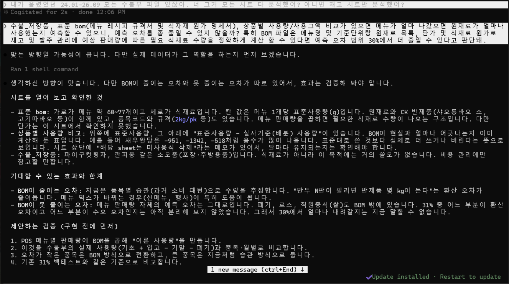

# F&B Pilot — 매장 입고·발주·매출 예측 도우미

F&B 매장 관리자가 매일 아침 "오늘 무엇을 발주해야 하나, 재고는 언제 떨어지나, 이번 주 매출은 어떤가"를 한 화면에서 보고 판단하도록 돕는 프로그램입니다. 현장에서 엑셀과 수기로 재고·발주를 계산하던 경험에서 출발했습니다. 관리자를 대신하는 AI가 아니라, 경험으로 하던 판단을 데이터가 보조하는 것이 목표입니다. 원래는 인건비와 매뉴얼까지 다루려 했지만, 중간 과제에서는 먼저 매출 예측과 발주·입고·재고를 구현했고 인건비·매뉴얼은 기말 과제에서 이어서 구현할 예정입니다.

- **대상 사용자:** F&B 점주, 매장 관리자, 슈퍼바이저 (현재는 수원점 1개 매장 데이터)
- **해결하려는 문제:**
1. 경험과 감에 의존하는 수기 발주: 직원이 매출을 직접 예상하고, 홀·FK(딤섬)·BK(요리) 파트가 각자 작성한 주간 표로 다음 입고 전까지 쓸 양을 대략 계산해 발주합니다. 매출이 예상과 다르면 과잉 발주는 폐기로, 과소 발주는 다른 지점에서 퀵으로 받아 오는 일로 이어집니다.
2. 월 1회 실사로는 원인을 찾을 수 없음: 재고를 월말에 한 번만 확인하다 보니 로스·역로스 품목이 매달 반복되고, 차이가 다음 달로 이월돼 커지기도 합니다. 언제, 어디서, 왜 생긴 차이인지 알기 어렵습니다.
3. 번거로운 단위 환산 입력: 실사 후 모든 품목을 박스·팩에서 g·개로 환산해 엑셀에 넣어야 해서 실수가 잦습니다.
- **데이터 범위:** 매출(POS)은 2024년 1월-2026년 10월 29일, 월별 수불부는 2024년 1월-2026년 9월, 구매청구·입고 리스트는 2026년 10월 30일까지입니다. 그 이후 재고는 예측값입니다.
- **저장소:** 실제 매장의 정제 데이터가 들어 있습니다.

## 실행 방법

**바로 보기:** [배포 앱 열기](https://fbpilot-arggke6ydwudytnnbmczh9.streamlit.app/) 

**내 컴퓨터에서 실행하기**

```bash
git clone https://github.com/miingjji/f_b_pilot.git
cd f_b_pilot/fb_agent
python -m venv venv && source venv/bin/activate
pip install -r requirements.txt
./run_real.sh
```

브라우저에서 `http://localhost:8501`을 엽니다. 실제 매장 데이터로 바로 뜨고, 근거가 없는 값은 `데이터 없음`으로 표시합니다.

**테스트:** `python -m unittest discover -p "test_*.py"` (440개)

## 작업 과정

### 1. 준비와 화면 뼈대
"매장 관리자가 매일 아침 발주·재고·매출을 한 화면에서 판단하도록 돕는 프로그램"을 목표로 GitHub 저장소와 VS Code f_b_pilot 폴더를 Claude Code와 연결했습니다. Claude가 만든 가상 데이터로 메뉴 56개, 달력 대시보드, 에이전트 패널을 Streamlit으로 만들어 UI/UX 뼈대를 잡았습니다.
### 2. 실제 매장 데이터로 교체
가상 데이터가 빈약해 2025년 12월 수불부에 발주→입고→재고를 잇는 구매청구·입고 리스트, 정산 리포트, POS 매출을 더했고, 학습·검증을 위해 2024년 1월~2026년 9월(33개월)로 늘렸습니다. 원본은 마크다운 표(data/source/)로 바꾸고 prep/ 도구로 열 이름·단위·합계를 맞춰 data/cleaned/ CSV로 정제했습니다.
### 3. 가상 데이터 제거
가상 데이터가 섞여 알고리즘이 망가지자 원재료·소모품·매출·스케줄·인건비·업체·리드타임 등을 지우고, 근거 없는 값은 데이터 없음으로 표시했습니다.
### 4. 예측 엔진 만들기
매출 예측→발주 엔진→재고·입고 시뮬레이션 순으로 쌓고, 단순 기준선(직전 주문량, 최근 3개월 평균)을 백테스트로 이긴 방법만 연결했습니다.
1. 발주 시점: 로지스틱 회귀(예측변수 7개)로 "오늘 이 품목을 발주할 확률"을 계산합니다.
2. 발주 수량: "직전 4회 중앙값×매출 규모비" 대신 "같은 요일 최근 3회 중앙값"(기록 2회 미만이면 직전 4회)을 써 2026년 1~9월 오차를 31.1%→26.0%로 줄였습니다. 규모비는 곱하면 26.2%→33.5%로 나빠져 뺐습니다.
3. 버린 방법: 수요×소비율(오차 43%), 추정 재고만으로 시점 판단(F1 58%), BOM과 영수증으로 매일 재고 계산(월말 재고 오차 63%, 기존 26%).
### 5. 현장 규칙 반영
백화점 휴무일, 공휴일·징검다리 평일, 불규칙한 소모품 발주, 원가·단가 상승은 제가 현장 규칙을 알려 주고 Claude가 데이터로 확인했습니다(예: 휴점 규칙이 2025·2026년 무매출일 24일을 모두 설명). 리드타임 기록이 없는 업체는 직접 지정했습니다.
### 6. 검증과 예측 동결
2024-2025년으로 학습하고 2026년 1-9월로 검증했습니다. 발주 시점은 F1 76.9%(AUC 0.82)로 간격 규칙(69.6%)보다 나았습니다. 9월 말 실사 기준 10-12월 예측을 data/forecast/2026-09_출발/에 동결하고 10월 구매청구·입고 리스트로 채점했습니다. 재생성을 막아 결과를 본 뒤 모수를 고칠 수 없게 했습니다.

## 검증 결과와 작업 증거

모든 수치는 예측을 만들 때 쓰지 않은 기간·자료로 잰 값입니다.

| 대상 | 방법 | 결과 | 비교 기준 |
|---|---|---|---|
| 발주 시점 | 2024-01 ~ 2025-12 학습, 2026-01 ~ 09 검증 | F1 76.9%, AUC 0.82 | 간격 규칙 69.6%, 전부 발주 66.2% |
| 발주 수량 | 같은 기간 (같은 요일 최근 3회 중앙값) | WAPE 26.0% | 직전 4회 주문량 그대로 32.3% |
| 월말 재고 | 시뮬레이션 백테스트(2025-07~2026-08 출발) | WAPE 31% (보정 후 약 29.8%) | 출발 재고 그대로 37% |
| 월 입고 / 소비 | 같은 백테스트 | WAPE 24% / 21% | 최근 3개월 평균 28% (입고) |
| 2026년 10월 발주일 | 동결 예측 vs 10/1~24 구매청구 | ±1일 정밀도 76%, 재현율 83% | '4주 전 반복'과 거의 같음 |
| 2026년 10월 입고량 | 같은 비교 | WAPE 31% | 기준선 34% |

**실패 사례:** BOM으로 발주량 예측하기
먼저 오차를 줄이기 위해 메뉴별 판매량과 BOM(표준 레시피)으로 식재료 사용량을 계산하면 발주량을 더 정확히 예측할 수 있다고 생각했습니다. 영수증 단위 매출과 BOM을 합쳐 사용량을 구하고, "다음 발주 도착 전까지 쓴 양이 발주량"이라고 가정해 2026년 1-9월 발주 5,028건과 비교했습니다. 월 사용량 오차는 25.5%에서 17-18%로 줄었지만, 발주량 오차는 약 60%로 직전 4회 발주량 중앙값 방식(33.0%)보다 나빴습니다. 발주의 76%가 3일 이내 반복 발주여서, 매장이 쓴 양보다 남은 재고를 눈으로 보고 발주하기 때문이라고 추정합니다. 그래서 사용량 대신 요일별 발주 패턴을 반영하도록 바꿨습니다.

**Claude Code 작업 화면** (`docs/evidence/`)

1. **원본 파일 확인** — 마크다운으로 변환해 올린 수불부 20개를 찾고, 이 과정 이후 24년도 수불부 파일도 추가해서 넣고 진행하였습니다.
   
2. **가상 데이터 제거** — 가상 값을 지우고 실제 데이터로만 활용하였습니다.
   
3. **검증 설계** — 학습·검증·보류 기간을 나누고, 단순 기준선을 먼저 만들어 비교하기로 했습니다.
   
4. **알고리즘 구조** — 매출 예측 → 품목 소비 → 재고·입고 → 발주 판단의 4단계입니다.
   
5. **현장 규칙 검증** — 사용자가 준 휴점 규칙이 2025·2026년 무매출일 24일을 모두 설명함을 데이터로 확인했습니다.
   
6. **BOM 활용 시도** — BOM에 메뉴 판매량을 곱해 식재료 사용량을 계산해 봤지만, 월말 재고 오차가 63%로 기존 방식보다 커서 적용하지 않았습니다.   
   

## 효과적이었던 실천 방법 3가지

1. **발주 수량 기준을 여러 방법으로 돌려 보고 가장 오차가 작은 것을 골랐습니다.** 직전 주문량, 최근 4회 중앙값 등 여러 기준을 비교하다가 '같은 요일 최근 3번 발주량의 중앙값'으로 바꾸자, 전체 기간 수량 오차가 32.9%에서 26.2%로 줄었고 2025년 1월 이후 22개월 모두 개선됐습니다.
2. **많은 원본 파일을 마크다운으로 변환한 뒤 정제했습니다.** 원본(`data/source/`)과 정제본(`data/cleaned/`)을 분리해 두어 규칙을 고치면 언제든 다시 만들 수 있었습니다.
3. **기준선과 백테스트를 먼저 놓고 채택 여부를 정했습니다.** 그럴듯해도 단순 기준선을 못 이기면 버리고, 왜 졌는지 남겨 같은 시도를 반복하지 않았습니다.

## 어려웠던 점 3가지

1. **일 단위 재고를 모르는 상태에서 재고 계산 방식을 정하는 일이 가장 힘들었습니다.** 실사재고를 월말에만 하기 때문에 하루 재고는 추정할 수밖에 없었습니다. 수불부의 BOM(메뉴 레시피 규격서) 시트와 매출입력(일사용량·매출영수증) 시트로 매일 소비량을 계산해 보았지만, 월말 실사와 견주어 보니 월말 재고 오차가 63%로, 기존 시뮬레이션(26%)보다 컸습니다. 어떤 방식으로 재고를 계산하고 발주 예측을 돌릴지 결정하기 어려웠습니다.
2. **품목은 많았지만 실제로 쓰는 품목은 적었습니다.** 마스터 품목 811개 중 최근 12개월 입고나 소비가 있던 품목은 293개뿐이었습니다. 발주 패턴이 매우 불규칙한 소모품·저장품을 걸러 내거나 '데이터 없음'으로 처리하는 데 시간이 오래 걸렸습니다.
3. **자료마다 단위와 기준이 다르고, 해마다 조건이 바뀌었습니다.** 구매청구(발주단위), 수불부(규격 단위), POS(금액)를 맞추고 33개월 수불부를 대조하는 작업이 가장 컸습니다. 여기에 식재료 가격 상승, 메뉴 단가 인상, 신메뉴 출시처럼 예상하지 못한 변화가 데이터에 섞여 있었습니다.

## 알려진 한계점

- **재고 오차가 큽니다 (가장 큰 한계).** 실사가 월말에만 있어 매일의 재고는 추정값이고, 품목별 월말 재고 오차가 약 30%입니다. 그래서 재고는 발주 시점을 바꾸지 않고 '재고 넉넉'·'재고 확인' 같은 참고 표시에만 씁니다.
- **예측 정확도:** 입고량 오차 약 31%, 발주일은 기준선 수준, 평일 매출 오차는 20% 안팎입니다.
- **검증 범위:** 수원점 한 곳의 데이터이고, 2026년 10월은 1-24일 구매청구·입고로만 검증했습니다.
- **기능 범위:** 유통기한·위생, 인건비, 매뉴얼은 기말에 구현할 예정이며, F&B Agent는 LLM이 아닌 키워드 규칙 기반입니다.
- **기타:** 45일 넘게 입고가 없던 시즌 품목은 마스터를 다시 만들어야 살아나고, 로그인은 데모이며 일정은 세션에만 저장됩니다.
- 
## 채점 대상 핵심 소스 파일

| 파일 | 역할 |
|---|---|
| [`fb_agent/inventory_sim.py`](fb_agent/inventory_sim.py) | 재고·입고 순환 시뮬레이션, 백테스트, 예측 동결·검증, 발주일 예측 |
| [`fb_agent/reorder_engine.py`](fb_agent/reorder_engine.py) | 발주 시점(확률)·수량 추천 엔진과 학습·검증 |
| [`fb_agent/sales_forecast.py`](fb_agent/sales_forecast.py) | 일 매출 예측, 공휴일·징검다리 보정, 예측 범위 |
| [`fb_agent/stock_sim.py`](fb_agent/stock_sim.py) | 동결 예측과 실제 구매청구를 화면용 재고·입고로 연결 |
| [`fb_agent/prep/app_master.py`](fb_agent/prep/app_master.py) | 정제 데이터에서 품목·거래처 마스터, 안전재고, 휴면 판정 생성 |
