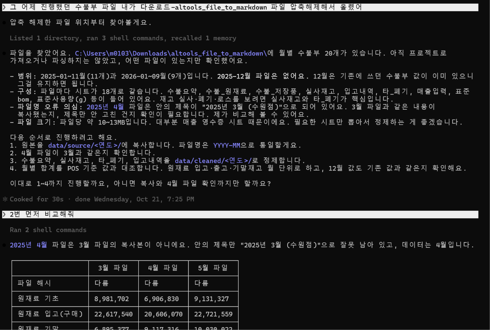
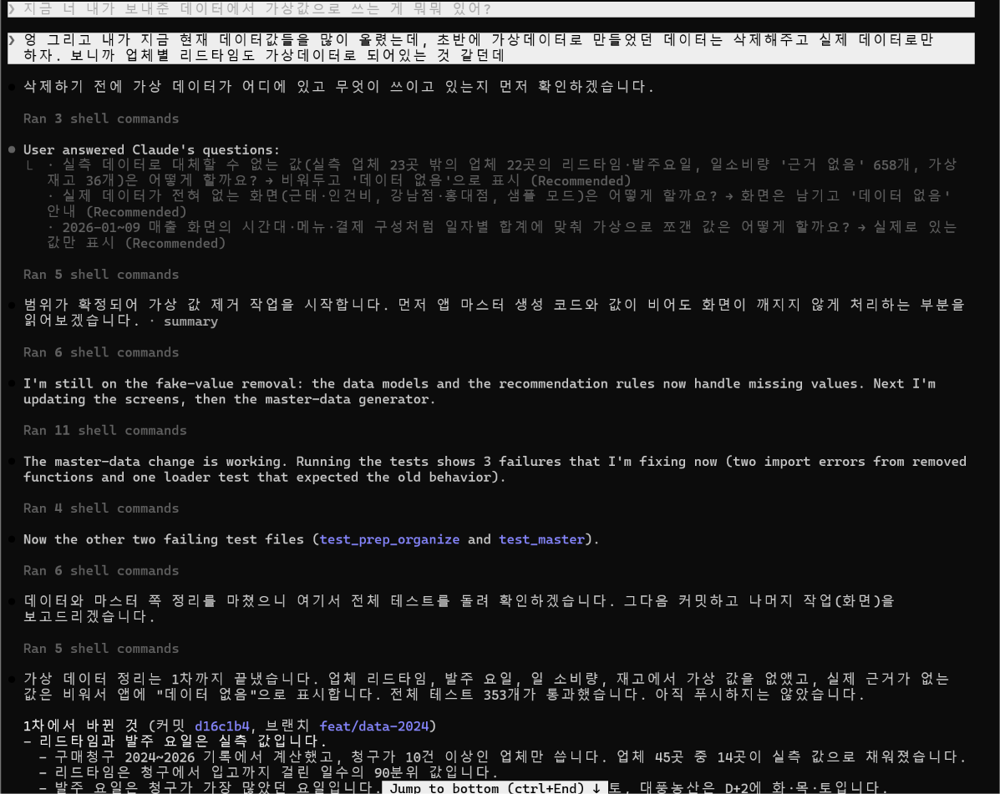
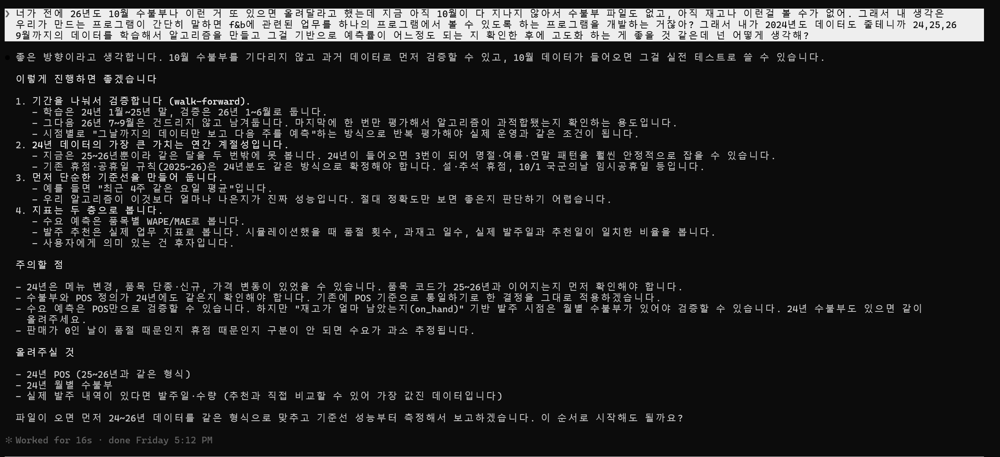
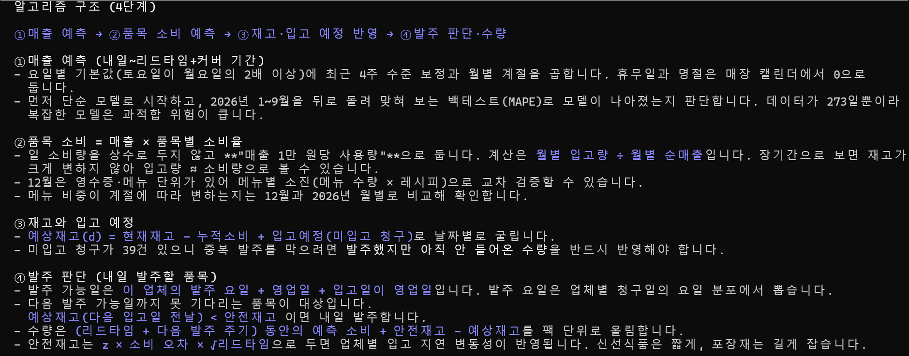
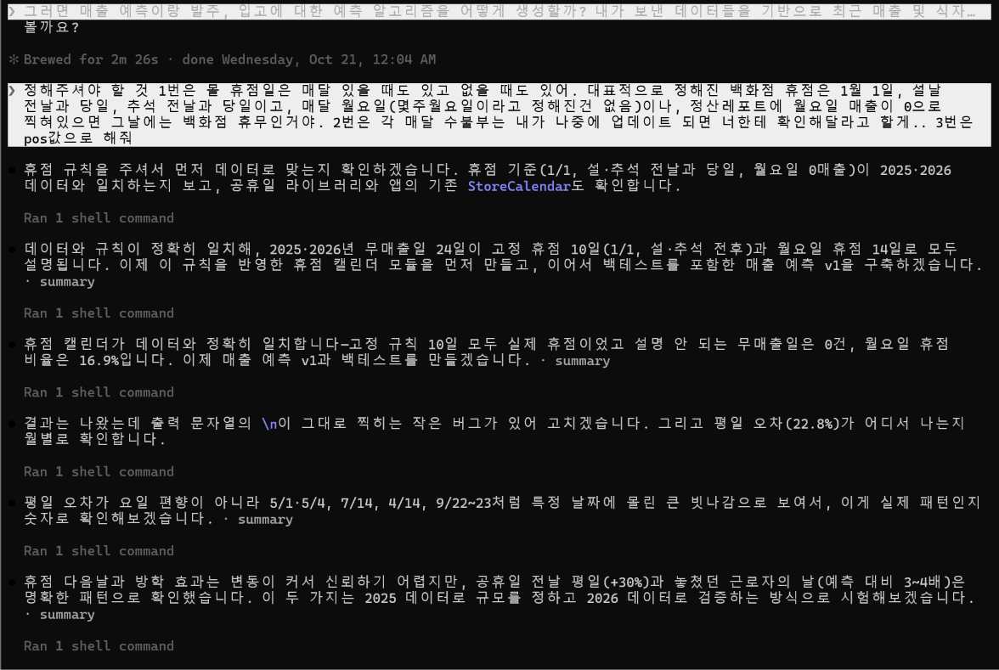

# F&B Pilot — 매장 입고·발주·매출 예측 도우미

F&B 매장 관리자가 매일 아침 "오늘 무엇을 발주해야 하나, 재고는 언제 떨어지나, 이번 주 매출은 어떤가"를 한 화면에서 보고 판단하도록 돕는 프로그램입니다. 현장에서 엑셀과 수기로 재고·발주를 계산하던 경험에서 출발했습니다. 관리자를 대신하는 AI가 아니라, 경험으로 하던 판단을 데이터가 보조하는 것이 목표입니다.

- **대상 사용자:** F&B 점주, 매장 관리자, 슈퍼바이저 (현재는 수원점 1개 매장 데이터)
- **해결하려는 문제:** 실사 재고 단위 환산, 거래처별 발주 요일·리드타임, 휴점일, 최근 매출을 사람이 매번 직접 계산하는 일
- **데이터 범위:** 매출(POS)은 2024년 1월~2026년 10월 29일, 월별 수불부는 2024년 1월~2026년 9월, 구매청구·입고 리스트는 2026년 10월 30일까지입니다. 그 이후 재고는 예측값입니다.
- **저장소:** 비공개. 실제 매장의 정제 데이터가 들어 있습니다.

## 실행 방법

```bash
cd fb_agent
python -m venv venv && source venv/bin/activate
pip install -r requirements.txt
./run_real.sh            # 또는 FB_MASTER=real streamlit run app.py
```

브라우저에서 `http://localhost:8501`을 엽니다. `data/real/`에 품목·거래처 마스터가 들어 있어 별도 준비 없이 실제 데이터로 뜹니다. 근거가 없는 값은 가상으로 채우지 않고 `데이터 없음`으로 표시합니다. 로그인 화면은 아이디·비밀번호를 비워도 들어가는 데모입니다.

```bash
python -m unittest discover -p "test_*.py"   # 단위·화면(AppTest) 테스트 440개
python inventory_sim.py --backtest           # 재고·입고 시뮬레이션 백테스트
python reorder_engine.py --fit 시작 끝        # 발주 확률 모델 재학습
python -m prep --help                        # 원본 마크다운 → 정제 CSV
```

주요 화면은 매출 분석과 예측, 구매/발주 > 발주관리(재고 기반)·발주 추천(이력 기반), 재고 입력·예측, 구매청구·입고입니다. 상세는 [fb_agent/README.md](fb_agent/README.md)와 `fb_agent/docs/`에 있습니다.

## 작업 과정

### 1. 준비와 화면 뼈대
Claude에게 "매장 관리자가 매일 아침 발주·재고·매출을 한 화면에서 판단하도록 돕는 프로그램"을 만들고 싶다고 설명했습니다. GitHub 저장소와 VS Code의 `f_b_pilot` 폴더를 만들어 Claude Code와 연결하고 초기 파일을 넣었습니다. 처음에는 Claude에게 가상 데이터를 만들어 달라고 해서, 그 데이터로 메뉴 56개, 달력 대시보드, 에이전트 패널을 Streamlit으로 먼저 만들었습니다. 이 단계에서 시스템의 UI/UX 뼈대를 잡았습니다.

### 2. 실제 매장 데이터로 교체
가상 데이터로 돌려 보니 실제 매장 데이터에 비해 너무 빈약하다는 것을 알게 되어 실제 데이터를 넣기 시작했습니다.
- 처음에는 2025년 12월 수불부 하나만 넣었습니다.
- 발주 → 입고 → 재고로 이어지는 순환 고리를 만들려면 이를 잇는 데이터가 필요하다고 느껴, 같은 달의 발주(구매청구) 리스트, 입고 리스트, 정산 리포트, POS 매출 데이터를 더했습니다.
- 한 달만으로는 예측할 데이터가 너무 적어 2026년 1~9월 자료를 추가했지만, 알고리즘을 학습하고 검증하기에는 여전히 부족했습니다.
- 그래서 2024년 1월~2025년 11월 자료까지 모두 넣어 총 33개월치를 모았습니다. 원본은 모두 마크다운 표로 변환해 `data/source/`에 두고, `prep/` 도구로 열 이름·단위·합계를 맞춰 `data/cleaned/` CSV로 정제한 뒤 웹 앱에 연결했습니다.

### 3. 가상 데이터 제거
실제 데이터를 연결하자 처음에 만든 가상 데이터와 섞이면서 알고리즘이 오히려 망가지기 시작했습니다. 그래서 처음 구상할 때 만든 가상 데이터(원재료, 소모품, 매출, 스케줄, 인건비, 업체, 리드타임 등)를 모두 지웠습니다. 근거가 없는 값은 채우지 않고 화면에 `데이터 없음`으로 표시하도록 바꿨습니다.

### 4. 예측 엔진 만들기
매출 예측 → 발주 엔진 → 재고·입고 시뮬레이션 순으로 하나씩 쌓았습니다. 방법을 바꿀 때마다 단순 기준선(예: 직전 주문량 그대로, 최근 3개월 평균)과 백테스트로 비교했고, 기준선을 이긴 방법만 화면에 연결했습니다.
- **발주 시점:** 로지스틱 회귀(예측변수 7개)로 "오늘 이 품목을 발주할 확률"을 계산합니다.
- **발주 수량:** 처음에는 "직전 4회 주문량 중앙값 × 매출 규모비"를 썼습니다. 여러 기준을 돌려 본 끝에 "오늘과 같은 요일의 최근 3회 주문량 중앙값"으로 바꿨고(같은 요일 기록이 2회 미만이면 직전 4회 중앙값), 2026년 1~9월 수량 오차가 31.1%에서 26.0%로 줄었습니다. 규모비를 함께 곱하면 오히려 26.2%에서 33.5%로 나빠져서 수량 계산에서는 뺐습니다.
- **버린 방법:** 수요 × 소비율로 수량 계산(오차 43%), 추정 재고만으로 발주 시점 판단(F1 58%), BOM(메뉴 레시피)과 일별 매출영수증으로 매일 재고 계산(월말 재고 오차 63%, 기존 시뮬레이션은 26%).

### 5. 현장 규칙 반영
실제 데이터를 쓰다 보니 데이터만으로는 설명되지 않는 불규칙한 날과 품목이 계속 나왔습니다. 백화점 고정 휴무일, 평일이지만 공휴일이라 주말처럼 운영되는 날, 공휴일과 주말 사이에 낀 징검다리 평일, 발주가 불규칙한 소모품, 원재료 원가와 메뉴 단가 상승 등입니다. 이런 부분은 제가 현장 경험으로 규칙을 알려 주고 Claude가 데이터로 맞는지 확인하는 식으로 보정했습니다. 예를 들어 제가 알려 준 휴점 규칙이 2025·2026년 무매출일 24일을 모두 설명하는지 데이터로 확인했습니다. 파일에 리드타임 기록이 없는 몇몇 업체는 제가 직접 지정했습니다.

### 6. 검증과 예측 동결
2024년 1월~2025년 12월 자료로 학습하고 2026년 1~9월 자료로 검증했습니다. 발주 시점은 F1 76.9%(AUC 0.82)로 간격 규칙(69.6%)보다 나았습니다. 마지막으로 2026년 9월 말 실사에서 출발한 10~12월 예측을 `data/forecast/2026-09_출발/`에 동결해 두고, 이후 들어온 10월 구매청구·입고 리스트로 채점했습니다. 같은 이름으로 다시 만들면 거부되게 해서, 결과를 보고 모수를 고치는 일을 막았습니다.

## 검증 결과와 작업 증거

모든 수치는 예측을 만들 때 쓰지 않은 기간·자료로 잰 값입니다.

| 대상 | 방법 | 결과 | 비교 기준 |
|---|---|---|---|
| 발주 시점 | 2024-01~2025-12 학습, 2026-01~09 검증 | F1 76.9%, AUC 0.82 | 간격 규칙 69.6%, 전부 발주 66.2% |
| 발주 수량 | 같은 기간 (같은 요일 최근 3회 중앙값) | WAPE 26.0% | 직전 4회 주문량 그대로 32.3% |
| 월말 재고 | 시뮬레이션 백테스트(2025-07~2026-08 출발) | WAPE 31% (보정 후 약 29.8%) | 출발 재고 그대로 37% |
| 월 입고 / 소비 | 같은 백테스트 | WAPE 24% / 21% | 최근 3개월 평균 28% (입고) |
| 2026년 10월 발주일 | 동결 예측 vs 10/1~24 구매청구 | ±1일 정밀도 76%, 재현율 83% | '4주 전 반복'과 거의 같음 |
| 2026년 10월 입고량 | 같은 비교 | WAPE 31% | 기준선 34% |

기준선보다 나빠 버린 방법: 수요×소비율 수량 계산(오차 43%), 재고 추정만으로 발주 시점 판단(F1 58%), 발주 엔진을 입고 생성기로 쓰기(오차 70~200%).

**Claude Code 작업 화면 5장** (`docs/evidence/`)

1. **원본 파일 확인** — 마크다운으로 변환해 올린 수불부 20개를 찾고, 4월 파일이 3월 복사본이 아니라 제목만 잘못 남은 4월 데이터임을 해시·합계 대조로 밝혔습니다.
   
2. **가상 데이터 제거** — 가상 값을 지우고 실측으로 바꾼 뒤 테스트 353개 통과를 확인했습니다.
   
3. **검증 설계** — 학습·검증·보류 기간을 나누고, 단순 기준선을 먼저 만들어 비교하기로 했습니다.
   
4. **알고리즘 구조** — 매출 예측 → 품목 소비 → 재고·입고 → 발주 판단의 4단계입니다.
   
5. **현장 규칙 검증** — 사용자가 준 휴점 규칙이 2025·2026년 무매출일 24일을 모두 설명함을 데이터로 확인했습니다.
   

자동 테스트 440개 통과 (`test_inventory_sim.py`, `test_reorder_engine.py`, `test_sales_forecast.py`, `test_stock_sim.py`, `test_prep_*.py` 등). 방법·수치 문서는 `fb_agent/docs/INVENTORY_SIM.md`, `DATA_CLEANING.md`, `LEDGER_RECONCILE.md`에 있습니다.

## 효과적이었던 실천 방법 3가지

1. **발주 수량 기준을 여러 방법으로 돌려 보고 가장 오차가 작은 것을 골랐습니다.** 직전 주문량, 최근 4회 중앙값 등 여러 기준을 비교하다가 '같은 요일 최근 3번 발주량의 중앙값'으로 바꾸자, 전체 기간 수량 오차가 32.9%에서 26.2%로 줄었고 2025년 1월 이후 22개월 모두 개선됐습니다.
2. **많은 원본 파일을 마크다운으로 변환한 뒤 정제했습니다.** 원본(`data/source/`)과 정제본(`data/cleaned/`)을 분리해 두어 규칙을 고치면 언제든 다시 만들 수 있었습니다.
3. **기준선과 백테스트를 먼저 놓고 채택 여부를 정했습니다.** 그럴듯해도 단순 기준선을 못 이기면 버리고, 왜 졌는지 남겨 같은 시도를 반복하지 않았습니다.

## 어려웠던 점 3가지

1. **일 단위 재고를 모르는 상태에서 재고 계산 방식을 정하는 일이 가장 힘들었습니다.** 실사재고를 월말에만 하기 때문에 하루 재고는 추정할 수밖에 없었습니다. 수불부의 BOM(메뉴 레시피 규격서) 시트와 매출입력(일사용량·매출영수증) 시트로 매일 소비량을 계산해 보았지만, 월말 실사와 견주어 보니 월말 재고 오차가 63%로, 기존 시뮬레이션(26%)보다 컸습니다. 어떤 방식으로 재고를 계산하고 발주 예측을 돌릴지 결정하기 어려웠습니다.
2. **품목은 많았지만 실제로 쓰는 품목은 적었습니다.** 마스터 품목 811개 중 최근 12개월(2025-10~2026-09) 입고나 소비가 있던 품목은 293개뿐이었습니다. 발주 패턴이 매우 불규칙한 소모품·저장품을 걸러 내거나 '데이터 없음'으로 처리하는 데 시간이 오래 걸렸습니다.
3. **자료마다 단위와 기준이 다르고, 해마다 조건이 바뀌었습니다.** 구매청구(발주단위), 수불부(규격 단위), POS(금액)를 맞추고 33개월 수불부를 대조하는 작업이 가장 컸습니다. 여기에 식재료 가격 상승, 메뉴 단가 인상, 신메뉴 출시처럼 예상하지 못한 변화가 데이터에 섞여 있었습니다.

## 알려진 한계점

- **재고 오차가 큽니다 (가장 큰 한계).** 수불부(입고·재고 실사)를 월말에만 작성하기 때문에, 하루 재고량을 본 뒤 발주를 판단하는 이 프로그램의 방식과 자료 주기가 맞지 않습니다. 매일의 재고는 마지막 월말 실사에서 소비·입고를 굴려 만든 추정값이라 오차 범위가 큽니다(품목별 월말 재고 WAPE 약 30%). 입고가 몰려 들어오는 주기 때문에 품목별 오차는 모수 튜닝으로도 줄이지 못했습니다. 그래서 재고 기반 판단은 발주 시점을 바꾸지 않고 '재고 넉넉'·'재고 확인' 같은 참고 표시에만 씁니다. 일별 실사가 쌓이면 가장 먼저 좋아질 부분입니다.
- **예측 정확도:** 입고량 WAPE 약 31%, 발주일은 기준선 수준입니다. 평일 매출 오차는 20% 안팎이라 P10~P90 범위로 보여 줍니다.
- **2026년 10월 이후는 예측입니다.** 10월 수불부로 하는 월 전체 검증은 하지 못했고, 10월 1~24일 구매청구·입고만 검증했습니다.
- **한 매장 데이터:** 수원점 하나로 만들고 검증했습니다. 다른 매장에서의 정확도는 모릅니다.
- **기능 범위:** 유통기한·위생, 인건비 연동, 매뉴얼 RAG는 이번 과제에서 구현하지 못했습니다. F&B Agent도 LLM이 아닌 키워드 규칙 기반입니다. 매뉴얼과 인건비 기능은 기말 과제에서 구현할 예정입니다.
- **휴면·시즌 품목:** 입고가 45일 넘게 없던 시즌 품목은 입고가 생긴 뒤 마스터를 다시 만들어야 살아납니다.
- **인증·저장:** 로그인은 비밀번호 없는 데모이고 일정은 세션에만 저장됩니다.

## 채점 대상 핵심 소스 파일

| 파일 | 역할 |
|---|---|
| [`fb_agent/inventory_sim.py`](fb_agent/inventory_sim.py) | 재고·입고 순환 시뮬레이션, 백테스트, 예측 동결·검증, 발주일 예측 |
| [`fb_agent/reorder_engine.py`](fb_agent/reorder_engine.py) | 발주 시점(확률)·수량 추천 엔진과 학습·검증 |
| [`fb_agent/sales_forecast.py`](fb_agent/sales_forecast.py) | 일 매출 예측, 공휴일·징검다리 보정, 예측 범위 |
| [`fb_agent/stock_sim.py`](fb_agent/stock_sim.py) | 동결 예측과 실제 구매청구를 화면용 재고·입고로 연결 |
| [`fb_agent/prep/app_master.py`](fb_agent/prep/app_master.py) | 정제 데이터에서 품목·거래처 마스터, 안전재고, 휴면 판정 생성 |
